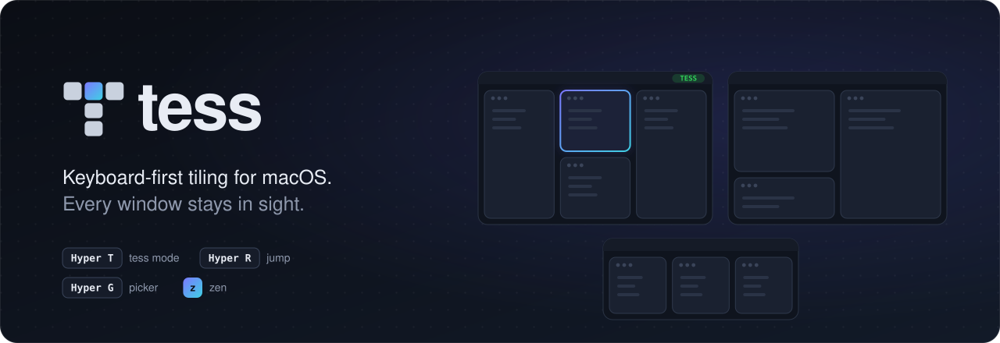
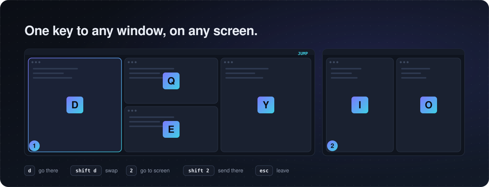
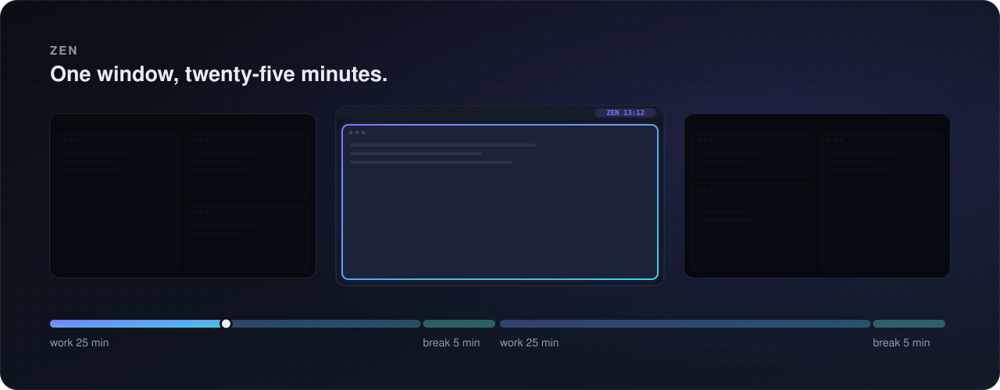

<p align="center">
  
</p>

A keyboard-first tiling window manager for macOS 27 that never hides a window. Each screen
is a row of columns, each column a stack or an accordion. There are no virtual workspaces,
so a crash, a hang or an unplugged screen cannot strand a window off-screen.

## Install

macOS 27 on Apple Silicon.

```sh
brew tap jonaprieto/tap
brew trust --formula jonaprieto/tap/tess
brew install jonaprieto/tap/tess
brew services start tess   # now and at login
```

From source:

```sh
make install   # build, sign, start at login and after a crash; links ~/.local/bin/tess
make test
```

macOS asks once for Accessibility. To remove it: `brew services stop tess && brew uninstall tess`,
or `make uninstall`.

## Keys

Hyper is ⌃⌥⇧⌘ (Nav+T, Nav+G and Nav+R on the NuPhy Air96 layout send Hyper+T, Hyper+G and
Hyper+R).

- `alt-h/j/k/l` focus, `alt-shift-h/j/k/l` move, `alt-1/2/3` go to a screen,
  `alt-shift-1/2/3` send the window there, `alt-tab` next screen.
- `alt-enter` fullscreen within tess, `alt-slash` columns or rows, `alt-shift-slash`
  accordion, `alt-shift-minus/equal` narrower or wider, `alt-shift-0` balance,
  `alt-shift-space` float, `alt-r` resize mode.
- `alt-shift-backspace` sends every window on this screen to the next one.
- `alt-shift-semicolon` re-tiles from where the windows are now.
- `alt-t` opens a terminal window (iTerm, or the app `terminal` names).
- Hyper+T is tess mode: the same actions without a modifier (`h`, `shift-h`, `1`, `f`, `a`,
  `v`, ...), plus `x` to close the window and pick what fills its place, `w` to bring back
  lost windows, `s` to re-tile, `r` for resize mode. It lasts one command; Hyper+T again
  keeps it on until esc.
- Hyper+G opens the picker, Hyper+R jump mode, in tess mode too.

The menu bar item names the mode that is on. Clicking it lists the last ten layout changes
(keys, CLI, menu and picker): clicking one undoes it and everything after it, clicking an
undone one redoes up to it. In tess mode `u` undoes and `shift-u` redoes.

While a mode is on, its keys show on screen. Keys for screens that are not attached are not
shown and stay with apps. `tess default-config` prints every binding.

## Jump mode



Every window shows a border and a letter on its top edge, every screen its number in the
bottom-left corner. A window keeps its letter while it lives.

- letter: focus that window; shift+letter: swap it with the focused window.
- digit: focus that screen; shift+digit: send the focused window there.
- esc: leave.

Outside jump mode the focused window keeps its border and, with more than one screen, the
active screen an outline. With `"overlay": {"window_labels": "always"}` every label stays on
screen all the time; `"off"` shows none.

## Zen



Zen (`z` in tess mode, `tess zen`, or the menu) is a pomodoro: for 25 minutes the focused
window fills its screen and the other screens go dark, then a 5 minute break with the layout
as it was, until Zen is turned off. The menu bar counts down. Clicking a dark screen focuses
what is under it, and Zen follows.

## Picker

Type to filter windows (on every Space), Brave and Safari tabs, and apps; once you type, also
Brave bookmarks and browser history. Enter on a window, tab or app shows a map of every
screen to choose where it goes:

- letter or shift+letter: swap with that window; alt+letter: go beside it.
- enter: next to the focused window; digit: that screen; `g`: just go there; `f`: float.

The first word can also be a verb:

- `cd ~/folder`, `code ~/folder`: open the folder in iTerm or VS Code (tab completes).
- `f name`: files by name (Spotlight, ranked by fzf); `rg text`: text in files.
- `book title author`, `paper title author`: find with [folio](https://github.com/jonaprieto/folio)
  (papers also on arXiv first), download to `~/Downloads` and open.

## Settings

Settings in the menu bar item (or `tess settings`) edits gaps, overlays, labels, picker verbs,
app lists and key bindings. It writes only what differs from the defaults to
`~/.config/tess/config.json`, which layers on top of the built-in config: lists replace,
bindings merge per key, and `null` removes a default binding. A config only needs what you
change, for example:

```json
{"gaps": {"inner": 6}, "terminal": "Ghostty", "modes": {"main": {"alt-s": "exec open -a Slack", "cmd-h": null}}}
```

`float` lists apps that never tile, `tile` apps that always do, `ignore` apps tess leaves
alone (EdgeMark is there by default). `terminal` is the app `alt-t` opens. `"one_shot": []`
keeps tess mode on until esc.

`history` lists the browsers whose bookmarks and history the picker reads, first one first
(`["com.brave.Browser", "com.apple.Safari"]` by default): it wins ties, a page both have
shows once from it, and a browser left out is not read.

New windows open on an empty screen when there is one, and Settings and a mode's keys show
on the screen with the fewest windows; `"empty_screens": false` turns that off.

## Command line

`tess <command>` runs any command a key can, for example `tess focus left` or
`tess move-to-screen 2`. Also:

- `tess tree`: screens, columns and windows, and what is not tiled.
- `tess state`: the model and the machine as JSON.
- `tess rescue`: bring back windows that are mostly off-screen.
- `tess pause`: stop tiling until run again (also in the menu).
- `tess undo`, `tess redo`: the last layout change.
- `tess zen`: Zen on or off.
- `tess reload`, `tess default-config`, `tess --version`.

## Permissions

Accessibility, asked at first start. Automation for Brave and Safari, asked the first time
the picker reads tabs. Browser history also needs Full Disk Access (System Settings, Privacy
& Security) for the tess binary: `$(brew --prefix)/opt/tess/bin/tess` from Homebrew, or
`~/tess/build/tess` from source. Without it the picker still lists tabs and Brave bookmarks.

## Logs

- `~/Library/Logs/tess/events.jsonl`: one JSON object per line for everything that changes:
  apps and windows opening and closing, focus, every command and where it came from (key,
  CLI, menu, picker), the layout after it, screens, Spaces, modes, picks and config reloads.
  A snapshot of the model and the machine is written at start, on screen changes and every
  ten minutes. Rotated at 20 MB. It stays on this Mac; picker queries are not recorded.
- `~/Library/Logs/tess.log`: short human-readable notes.

Limits: macOS Spaces other than native fullscreen are not modeled; an app with a minimum
size can overlap its neighbor.
