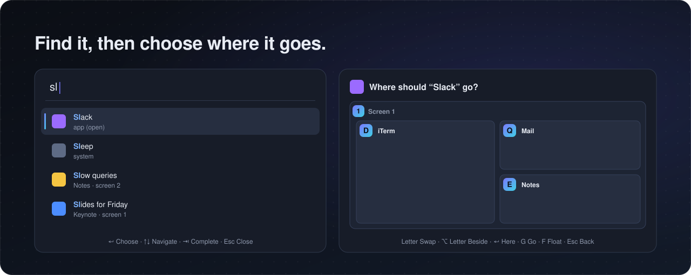

<p align="center">
  
</p>

tess keeps your Mac's windows in order. Every window gets its own place on the screen, and
any of them is one keypress away. Open an app and it finds a spot, close one and the others
fill the gap. There are no virtual workspaces, so a crash, a hang or an unplugged screen
cannot strand a window off-screen.

## Why tess

- Windows arrange themselves. A new one takes a place, its neighbors make room, and an app
  that needs a minimum size gets it.
- One key reaches any window. `⌥T` puts a letter on every window and browser tab; press the
  letter and you are there.
- `⌘Space` finds anything: windows on every Space, browser tabs, apps, files, bookmarks,
  books and papers. It also does arithmetic and runs commands and Shortcuts.
- You choose where things open. Pick a window or app and a map of your screens lets you put
  it exactly where you want, in one key.
- `⌘Tab` shows windows, not just apps, as cards with their screen, memory use and how long
  they have been open.
- `⌥F` clicks without the mouse: everything clickable in the front window gets a label.
- Zen gives you 25 minutes on one window with the other screens dark, then a real 5 minute
  break.
- Every layout change can be undone, the mouse works too, and any Mac keyboard will do, the
  laptop's included.
- It speaks English and Spanish, follows your light or dark theme, and uses next to no CPU
  at rest.

## Get started

You need macOS 27 on Apple Silicon.

```sh
brew tap jonaprieto/tap
brew trust --formula jonaprieto/tap/tess
brew install jonaprieto/tap/tess
brew services start tess   # now and at login
```

macOS asks once for Accessibility. Then take the short walkthrough with `tess tutorial`,
which you can repeat any time from the menu bar. It rearranges nothing.

These keys are enough for your first day:

| Key | What it does |
| --- | --- |
| `⌘Space` or `⌥Space` | Open the picker |
| `⌥T` | Letters on every window; press one to go there |
| `⌥H` `⌥J` `⌥K` `⌥L` | Focus the window left, down, up or right |
| `⌥⇧H` `⌥⇧J` `⌥⇧K` `⌥⇧L` | Swap the window with the one that way |
| `⌘⇧=` and `⌘⇧-` | Make it bigger or smaller |
| `⌥⇧0` | Make everything even |
| `⌥Return` | Fullscreen, without leaving your Space |
| `⌥F` | Click by label |
| `⌥⇧C` | Close the window |
| `⌥⇧Z` | Zen on or off |
| `⌥⇧W` | Keep the Mac awake, or let it sleep |

If Spotlight owns `⌘Space`, turn its shortcut off in System Settings → Keyboard → Keyboard
Shortcuts → Spotlight, or use `⌥Space`. While a mode is on, its keys show on screen, so
there is nothing to memorize.

<details>
<summary>Open it from Finder, build from source, or uninstall</summary>

To open tess from Finder or Spotlight, copy the app. It opens Settings, or starts tess again
after Quit.

```sh
cp -R "$(brew --prefix tess)/tess.app" /Applications/
```

From source:

```sh
make install   # build, sign, start at login and after a crash; links ~/.local/bin/tess, adds tess.app
make test
make hooks     # before each commit: formatted, and no compiler warnings (needs pre-commit)
make format    # what the first of those checks
```

`make install` also installs [Folio](https://github.com/jonaprieto/folio) through Homebrew if it
is missing.

To remove it: `brew services stop tess && brew uninstall tess`, or `make uninstall`.

</details>

<details>
<summary>Something not working? Run tess doctor</summary>

`tess doctor`, or Doctor… in the menu bar, checks macOS, Accessibility, your configuration,
the terminal app, and every binary each feature uses in the service's PATH, with how to
install what is missing. It changes no settings, and missing required checks return exit
code 1. Rerun it after granting Accessibility.

Homebrew installs [Folio](https://github.com/jonaprieto/folio) for book and paper search.
`brew install ripgrep fzf` adds search inside files and better file ranking.

</details>

## Jump to any window


`⌥T` is tess mode. Every window and tab in sight wears a letter, every screen its number, and
the letter takes you there. `shift` and a letter swaps that window with yours, a digit goes
to that screen, and `shift` and a digit sends your window there. It lasts one command; press
`⌥T` twice to keep it on until `esc`, with every action on a plain key: `h`, `shift-h`, `f`
for fullscreen, `u` to undo, `z` for Zen, `t` for a terminal, `x` to close a window and pick
what fills its place.

Not sure where to go? Hold `⌥` on its own for 3 seconds and the letters appear. Press one with
`⌥` still down to go there, or let go to carry on as you were.

## Find anything



Type a few letters, in any order: `report budget` finds "Budget report - Numbers". Enter on
a window, tab or app shows a map of your screens:

- A letter puts it in that window's place. A new window shares the place, so the rest of
  your layout stays as it was; one already tiled swaps with it.
- `⌥` and a letter puts it beside that window, Enter next to the focused one, and a digit on
  that screen. `g` just goes there, and `f` floats it.

The first word can also be a verb:

- `cd ~/folder`, `code ~/folder`: open the folder in iTerm or VS Code, with tab completion.
- `f name`: files by name. `rg text`: text inside files.
- `web text`: browser tabs, bookmarks and history. An address opens directly.
- `book title author`, `paper title author`: find with
  [Folio](https://github.com/jonaprieto/folio), download to `~/Downloads` and open.
- `slack name`: jump to that channel or person.
- `chat text`, `claude text`: start a ChatGPT or Claude chat with that text.
- `brew install fzf`: run it in your terminal.

It also computes `2 * (3 + 4)`, lists your Shortcuts, offers Sleep, Lock Screen, Log Out,
Restart and Shut Down, and runs any tess command on the window you had focused. It remembers
your last 100 queries on this Mac; Tab brings them back.

<details>
<summary>Picker details: warnings, Do Not Disturb, plain-language search and custom verbs</summary>

Amber keys and "may not fit" warnings mark destinations that would squeeze a window below a
size it kept after refusing a resize. The choice stays available, and unknown size limits are
not predicted.

Bookmarks and browser history only show after `web`, so they never crowd out a window or an
app. A matching recent query appears below the results as you type. Tab fills it in, or
recalls the latest query in an empty field; folder completion takes priority, and Escape
saves nothing.

Focus has no API, so Do Not Disturb comes from a shortcut: one made in the Shortcuts app with
its Set Focus action, named "Do Not Disturb", is then `do not` away in the picker.

With `"jev": true` the picker also asks [TypeSafe](https://typesafe.ai)'s Jev what the text
means, after a short pause in typing, so plain words (`the standup call`, `send this to the
other screen`) and typos find their window, tab, app or command. It sends the typed text, the
focused window and the titles of windows, tabs, apps and commands to TypeSafe's API, never
browser history, with `TYPESAFE_API_KEY` from the environment or the login shell. Off by
default.

Verbs are config, merged key by key. A value is an app (`cd`), a link with `%s` (`chat`), one
of tess's searches (`search:files`, `search:text`, `search:books`, `search:papers`,
`search:history`), `keys:App:shortcut` (`slack`), which brings the app forward, presses the
shortcut and types the text, or `run:` and a command with `%s` (`brew`), run in the `terminal`
app.

```json
{"verbs": {"f": null, "find": "search:files", "g": "https://www.google.com/search?q=%s",
           "vs": "keys:Visual Studio Code:cmd-p", "sh": "run:%s"}}
```

That renames the file search, adds a Google verb, opens a file in VS Code by name, and runs
whatever is typed. `web` also has `brave`, and `f` also has `file`. Books and papers use
[Folio](https://github.com/jonaprieto/folio), with arXiv first for papers.

</details>

## Switch with ⌘Tab

`⌘Tab` shows a card for every window, and for each running app with none, with its screen,
memory use and how long it has been open. Tab steps through them, a card's letter goes
straight there, and the window you are about to land on is outlined on screen, even when it
sits behind others. With a ribbon on, a map of it sits above the cards: where the screen is
along it, what is out of view, and that window lit.

## Focus with Zen


Zen (`⌥⇧Z`, `z` in tess mode, `tess zen`, or the menu) is a pomodoro that means it. For 25 minutes
the focused window fills its screen and the others go dark, with a countdown in the menu bar.
Then comes a 5 minute break: every screen goes black with the time left, and no key or click
gets through until it is over. `break` starts one now, and the menu counts the breaks you
took today.

## Arrange with the menu or the mouse

Click the menu bar item for pictures of your screen as halves, columns, rows, a grid or
fullscreen; click one to arrange it. History holds your last ten layout changes: click one to
undo it and everything after it, or an undone one to redo up to it.

Drag a tiled window and where it will land shows in orange. Drop it on another window's left
or right edge to split beside it, on its top or bottom edge to stack with it, or on its
middle to swap the two.

`⌥⇧A` brings every app back: each running app with no window in sight gets one, and every
screen is laid out with them.

`⌥⇧W`, or Keep Awake in the menu, stops your Mac sleeping and shows a yellow dot in the menu
bar until you turn it off, and the picker reaches volume, Wi-Fi and a speed test.

<details>
<summary>All default keys</summary>

`alt` is ⌥ Option. `tess default-config` prints every binding, and keys for screens that are
not attached stay with your apps.

Focus and move:

- `alt-h/j/k/l` focus, `alt-n/p` the next or previous window (every screen, then the floating
  ones).
- `alt-shift-h/j/k/l` swap the window with the one that way, on this screen or the next, so the
  tiling keeps its shape. To change the tiling itself, drag a window, use the picker, or
  `alt-slash`.
- `alt-1/2/3` go to a screen, `alt-shift-1/2/3` send the window there, `alt-tab` and
  `alt-shift-tab` the next or previous screen.
- `alt-shift-backspace` sends every window on this screen to the next one.

Layout:

- `alt-enter` fullscreen within tess, `alt-slash` columns or rows, `alt-shift-slash` accordion.
- `alt-shift-minus/equal` (or `cmd-shift-minus/equal`) smaller or bigger: wider in columns and
  taller in rows, or the other way for windows stacked in the only column.
- `alt-shift-0` balance, `alt-shift-space` float, `alt-r` resize mode (`h/l` width, `j/k`
  height), `alt-shift-semicolon` re-tile from where the windows are now.

Everything else:

- `alt-t` tess mode, `alt-space` and `cmd-space` the picker, `alt-f` click mode.
- `alt-shift-a` show all apps, `alt-shift-c` close the window, `alt-shift-r` reload the config.
- `alt-shift-z` Zen, `alt-shift-w` keep the Mac awake or let it sleep.
- `cmd-h` and `cmd-alt-h` do nothing, so no window gets hidden by accident.

In tess mode, on top of the same actions without a modifier: `t` a terminal window, `x` close
the window and pick what fills its place, `w` bring back lost windows, `s` re-tile, `r` resize
mode, `b` balance, `f` fullscreen, `a` accordion, `v` columns or rows, `space` float, `u` and
`shift-u` undo and redo, `z` Zen, `g` ribbon.

A keyboard with programmable keys can also send Hyper (⌃⌥⇧⌘) and bind it. This is optional:

```json
{"modes": {"main": {"cmd-alt-ctrl-shift-t": "mode tess", "cmd-alt-ctrl-shift-g": "pick", "cmd-alt-ctrl-shift-r": "jump"},
           "tess": {"cmd-alt-ctrl-shift-t": "mode tess", "cmd-alt-ctrl-shift-g": "pick"}}}
```

</details>

<details>
<summary>How windows, fullscreen and jump mode behave</summary>

Each screen is a row of columns, each column a stack or an accordion.

Fullscreen within tess fills the screen edge to edge in front of its other windows until
`alt-enter` again, or another window there takes focus or opens, and it survives a restart. A
floating window joins the tiling to go fullscreen, and moving or resizing one says it floats.
macOS fullscreen (the green button, or a video's or call's own fullscreen) becomes fullscreen
within tess, so the window never leaves for a Space of its own.

Jump mode (`tess jump`, or a key bound to `jump`) is tess mode's letters without its other
keys. What is hidden behind another window gets no letter. Letters are the ones tess mode
leaves free (`d q e y i o c m` by default), windows first, and a window keeps its letter
while it lives.

Outside jump mode the focused window keeps a thin border and, with more than one screen, the
active screen a faint outline. The border steps aside while its window moves, and both hide
during Mission Control.

Every window but the focused one shows in black and white at 80%, so the eye goes to the one
in use. It is off while another app or Zen is in front.

Minimum sizes are learned the first time an app refuses a size, then applied before anything
moves, so a window lands once. A resize stops there, and the others keep the space tiled.

</details>

## Keep every window its width with a ribbon

Past three or four columns a screen runs out of room. A ribbon stops squeezing them: each
column keeps its width and the screen scrolls along them, the way a paper strip passes under a
window. Columns out of view wait along the bottom of the screen with their title bars showing.
Go to one with the keyboard, its letter, `⌘Tab` or a click, and the ribbon slides to it.

`g` in tess mode, `tess ribbon` or Ribbon in the menu turns it on or off for the screen in use,
each screen keeping its own. `"ribbon": true` starts every screen that way. Off again, the
columns share the screen as before.

<details>
<summary>How a ribbon behaves</summary>

A new column takes half the screen, so two fill it. `⌥⇧=` and `⌥⇧-` change only the column in
use and `⌥⇧0` takes the screen's columns back to half. A window takes its width along when it
swaps, and an app's minimum widens its own column and no other.

Columns of different widths seldom fill a screen exactly: one cut by the screen's edge stays out
when nothing lies past that edge. Next to another screen it waits on the strip instead, so
nothing lands on that screen.

The strip keeps 52 points of the screen even when nothing waits on it, so windows are not
resized each time one comes or goes. macOS keeps a window's title bar on screen, which is why
that is its depth, and why windows waiting there are never lost: quit tess and they are still
there to pick up. With a screen below, the strip moves to a free side, 20 points wide.

Windows on the strip overlap once there are more than two, and macOS decides which is in front,
but each keeps its letter in tess mode. They move without being resized, which spares apps from
laying out again. With Reduce Motion on in macOS the ribbon goes straight there instead of
sliding.

The picker's map shows all the columns side by side. After a restart with `"ribbon": true` the
columns in view come first and those on the strip follow them.

</details>

## Make it yours

Settings in the menu bar, or `tess settings`, edits gaps, colors, labels, language, picker
verbs, app lists and keys. It saves only what differs from the defaults to
`~/.config/tess/config.json`, so a config holds just what you change:

```json
{"gaps": {"inner": 6}, "terminal": "Ghostty", "language": "es",
 "modes": {"main": {"alt-s": "exec open -a Slack", "cmd-h": null}}}
```

<details>
<summary>Config reference</summary>

The config layers on top of the built-in one: lists replace, bindings and verbs merge per key,
and `null` removes a default.

- `float` lists apps that never tile, `tile` apps that always do, and `ignore` apps tess
  leaves alone (EdgeMark is there by default).
- `terminal` is the app `t` in tess mode opens. `"one_shot": []` keeps tess mode on until esc.
- `history` lists the browsers whose bookmarks and history the picker reads, first one first
  (`["com.brave.Browser", "com.apple.Safari"]` by default). The first wins ties, a page both
  have shows once from it, and a browser left out is not read.
- `"empty_screens": false` stops new windows going to an empty screen, and Settings and a
  mode's keys to the screen with the fewest windows.
- `"ribbon": true` starts every screen as a ribbon.
- `"language": "es"` or `"en"`. Left out, tess follows macOS: the first of its languages it
  speaks, else English. Commands, config keys, `tess --help`, `tess tree` and the logs stay in
  English.
- `"jev": true` turns on plain-language search in the picker.

Under `overlay`:

- `"window_labels"`: `"jump"` by default, `"always"` keeps every label on screen, `"off"` shows
  none.
- `"border_color"`, `"inactive_border_color"` and `"selection_color"`: `#rrggbb` values for
  focused borders and highlights, inactive borders, and selection and drag outlines. The accent
  color is the default, and a color that would not read in the current theme is adjusted for
  text and thin lines.
- `"gray_others": false` turns off the black and white, and `"gray_amount"` sets its strength
  from 0 to 1 (0.8 by default).
- `"all_screens": false` shows a mode's keys only on the screen in use, once `empty_screens`
  is off.

</details>

<details>
<summary>Get macOS behavior back</summary>

tess takes over a few things macOS does. In `~/.config/tess/config.json`, `null` gives a key
back; run `tess reload` after editing.

Hide apps with `⌘H` and `⌘⌥H`. tess turns these off so no window leaves the layout by accident:

```json
{"modes": {"main": {"cmd-h": null, "cmd-alt-h": null}}}
```

tess has no key to hide a single window. `⌘M` minimizes it as usual, `⌥⇧Space` floats it and
`⌥⇧C` closes it.

Spotlight on `⌘Space`. Remove the key in every mode, then turn its shortcut back on in System
Settings. The picker stays on `⌥Space`:

```json
{"modes": {"main": {"cmd-space": null}, "tess": {"cmd-space": null}, "resize": {"cmd-space": null}}}
```

Type with `⌥`. `⌥N` starts an ñ on many layouts, and tess uses it for the next window. The same
works for any key an app or your typing needs, such as `alt-tab`:

```json
{"modes": {"main": {"alt-n": null}}}
```

Zoom in apps with `⌘+`, which is `⌘⇧=`. Resizing stays on `⌥⇧=` and `⌥⇧-`:

```json
{"modes": {"main": {"cmd-shift-equal": null, "cmd-shift-minus": null}}}
```

Let an app be. `float` keeps its windows out of the tiling, and `ignore` hands the app back to
macOS entirely, its own fullscreen included. Both lists replace the defaults, so keep what you
still want; `tess default-config` prints them:

```json
{"ignore": ["io.github.ender-wang.EdgeMark", "com.example.app"]}
```

Everything for a while. Pause Tiling in the menu, or `tess pause`, stops tiling and releases
every key, the only way to get macOS's own `⌘Tab` back. Resume the same way.

</details>

<details>
<summary>Command line</summary>

`tess <command>` runs any command a key can, for example `tess focus left` or
`tess move-to-screen 2`, and typed in the picker they work too. Also:

- `tess tree`: screens, columns and windows, and what is not tiled.
- `tess state`: the model and the machine as JSON.
- `tess halves`, `columns`, `rows`, `grid`: arrange this screen.
- `tess rescue`: bring back windows that are mostly off-screen.
- `tess pause`: stop tiling until run again (also in the menu).
- `tess undo`, `tess redo`: the last layout change.
- `tess volume 30` (or `+10`, `-10`, `mute`, `unmute`).
- `tess wifi` (`on`, `off`, or the other way round).
- `tess caffeine`: keep the Mac awake until run again. `caffeine 60` for an hour, `caffeine off`.
- `tess speedtest`: download and upload speed and latency, with macOS's own `networkQuality`,
  in about 20 seconds.
- `tess zen`: Zen on or off. `tess break`: Zen's break now.
- `tess ribbon`: the screen in use becomes a ribbon, or stops being one.
- `tess doctor`, `tess tutorial`, `tess settings`.
- `tess reload`, `tess default-config`, `tess --version`.

</details>

<details>
<summary>Permissions, logs and privacy</summary>

Accessibility is asked at first start. Automation for Brave and Safari is asked the first time
the picker reads tabs. Browser history also needs Full Disk Access (System Settings, Privacy &
Security) for the tess binary: `$(brew --prefix)/opt/tess/bin/tess` from Homebrew, or
`~/tess/build/tess` from source. Without it the picker still lists tabs and Brave bookmarks.
Log Out, Restart and Shut Down may ask once for Automation of loginwindow.

Logs stay on this Mac, and picker queries are not recorded.

- `~/Library/Logs/tess/events.jsonl`: one JSON object per line for everything that changes:
  apps and windows opening and closing, focus, every command and where it came from, the layout
  after it, screens, Spaces, modes, picks and config reloads. A snapshot of the model and the
  machine is written at start, on screen changes and every ten minutes. Rotated at 20 MB.
- `~/Library/Logs/tess.log`: short human-readable notes.

</details>

<details>
<summary>Good to know</summary>

- macOS Spaces other than native fullscreen are not modeled.
- macOS shows a new window where its app puts it before tess can move it, for a blink.
- An app's minimum size is learned once per run of tess, so that first placement moves twice.
- Windows can overlap when the minimum sizes on a screen do not all fit.

</details>
